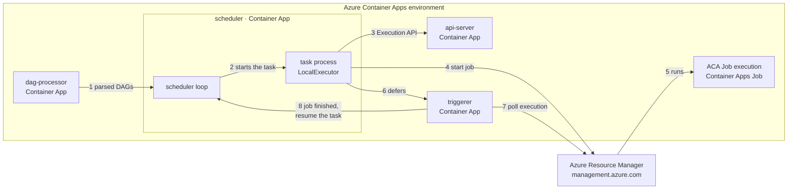
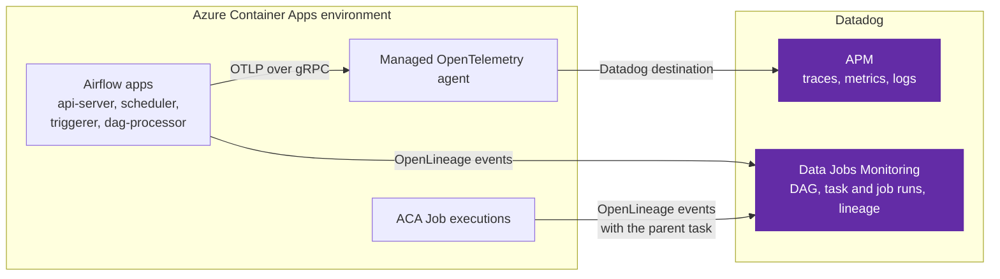

# Datadog for Airflow on Azure Container Apps

[](https://github.com/kyletaylored/airflow-aca-datadog/actions/workflows/ci.yml)

A working example of monitoring Apache Airflow 3 on Azure Container Apps (ACA) with
Datadog:

- **Data Jobs Monitoring** through OpenLineage: every DAG run, task, and the ACA
  Job runs those tasks launch, with dataset lineage.
- **APM** through OpenTelemetry and the ACA managed OTel agent: Airflow's own
  traces, metrics, and logs, plus a span for every Azure API call a task makes.

The Airflow-on-ACA deployment itself (the `azd` template, the ACA Jobs operator,
managed-identity auth) comes from
[hetvip2/airflow-hosted-on-aca](https://github.com/hetvip2/airflow-hosted-on-aca).
See that repo for the Airflow details. This repo adds the Datadog instrumentation
and demo DAGs that show it off.

**Contents:** [Architecture](#architecture) ·
[Minimum configuration](#minimum-configuration) ·
[DJM and APM compared](#data-jobs-monitoring-and-apm-compared) ·
[Airflow 2 and 3](#airflow-2-and-airflow-3-differences) ·
[Reference configuration](#reference-configuration) ·
[Deployment](#deployment) · [Known issues](#known-issues)

---

## Architecture

### How the components call each other



Each box is a separate app in one Container Apps environment. For a DAG run of
`contoso_sales`:

1. The **dag-processor** parses the DAG files and stores them in the metadata
   database, where the **scheduler** picks them up.
2. The scheduler creates the DAG run. With `LocalExecutor`, it starts each task as a
   process inside the scheduler's own container.
3. The task process reports its state, and reads variables and XComs, through the
   **api-server**'s Execution API.
4. The ACA Jobs operator asks Azure Resource Manager to start an execution of the
   ACA Job.
5. ARM starts the execution as a **Container Apps Job**.
6. The task defers, which hands the wait to the **triggerer** and frees the task's
   slot.
7. The triggerer polls ARM for the execution's status.
8. When the execution finishes, the trigger's event (through the metadata
   database) makes the scheduler resume the task, which records the result.

The scheduler and triggerer authenticate to ARM with a user-assigned managed
identity that has Contributor on the resource group. All four apps share a
PostgreSQL Flexible Server metadata database and mount the DAGs and plugins from an
Azure Files share at `/opt/airflow/shared`.

Datadog's trace map for a `contoso_sales` run shows this same path. It goes from
`airflow-aca-scheduler` to `airflow-aca-api-server`, then to the scheduler's task
spans and `airflow-aca-triggerer`, and from both of those to
`management.azure.com`. The `localhost` calls next to them are managed-identity
token requests: ACA serves its identity endpoint inside each container.

### Telemetry to Datadog



Telemetry reaches Datadog by two independent paths:

- **APM:** every Airflow app exports OTLP to the environment's managed
  OpenTelemetry agent, which forwards traces, metrics and logs to Datadog.
- **Data Jobs Monitoring:** the OpenLineage listener on the scheduler, where tasks
  run, and each ACA Job execution post OpenLineage events straight to Datadog's
  intake. The agent isn't involved.

---

## Minimum configuration

Two steps, and both are configuration only: no code changes, no custom image, no
Datadog Agent. Each step works on its own. **Start with step 1:** it covers what
pipeline owners ask about, and it already gives you a trace per DAG run.

### Step 1: Data Jobs Monitoring

Set four environment variables on the scheduler, and on your workers if you have
any. With `LocalExecutor`, tasks run in the scheduler, so the scheduler alone is
enough ([Datadog guide](https://docs.datadoghq.com/data_observability/jobs_monitoring/airflow/)).

```bash
OPENLINEAGE__TRANSPORT__TYPE=datadog
DD_API_KEY=<datadog-api-key>     # from a secret
DD_SITE=datadoghq.com            # your Datadog site
OPENLINEAGE_NAMESPACE=<env>      # shows up as the env tag
```

**You get:** every DAG run and task run in Data Jobs Monitoring, with status,
duration, retries, errors and dataset lineage, plus a trace per DAG run.

### Step 2: APM

**2a. Send the environment's telemetry to Datadog.** Turn on the Container Apps
environment's
[managed OpenTelemetry agent](https://learn.microsoft.com/azure/container-apps/opentelemetry-agents)
with a Datadog destination. It's one command:

```bash
az containerapp env telemetry data-dog set -g <resource-group> -n <environment> \
  --site datadoghq.com --key <datadog-api-key> --enable-open-telemetry-traces true
```

**2b. Turn on Airflow's tracing.** Set these on each Airflow app (api-server,
scheduler, triggerer, dag-processor), with each app's own service name:

```bash
AIRFLOW__TRACES__OTEL_ON=True
OTEL_SERVICE_NAME=airflow-scheduler                # per app
OTEL_RESOURCE_ATTRIBUTES=deployment.environment=<env>
```

ACA injects the agent's endpoint into every app. **Don't set any
`OTEL_EXPORTER_OTLP_*` variable yourself:** if you set even one, ACA stops
injecting all of them, and nothing is exported. Outside ACA, set
`OTEL_EXPORTER_OTLP_ENDPOINT` to a Datadog Agent with OTLP ingest turned on (for
example `http://<agent>:4317`) instead of doing 2a.

**You get:** one APM service per Airflow component, with traces of the scheduler,
the task process and the triggerer.

### What you don't need

- **No install on Airflow 3.** The official `apache/airflow` 3.x image already
  includes the OpenLineage provider and the OpenTelemetry SDK. Airflow 2 needs a
  bit more; see [Airflow 2 and Airflow 3 differences](#airflow-2-and-airflow-3-differences).
- **No DAG or operator changes.** Both work at the Airflow level.
- **No Datadog Agent.** Data Jobs Monitoring posts straight to Datadog's intake,
  and APM uses ACA's managed agent. (The optional
  [data pipeline demo](docs/data-pipeline-demo.md) adds an Agent for Postgres
  monitoring, which neither step needs.)

### Optional extras

Everything else in this repo builds on the two steps. Add any of these only when
you want what it gives you:

| Add | What it gives you | How |
|---|---|---|
| Airflow metrics | Scheduler heartbeats, executor and pool slots, DAG parse times | `AIRFLOW__METRICS__OTEL_ON=True`, and `--enable-open-telemetry-metrics true` in 2a |
| Logs with trace ids | Airflow's logs in Datadog, linked to their traces | The log handler in [`otel_logging_config.py`](airflow/plugins/otel_logging_config.py) (see [Additional instrumentation](#additional-instrumentation)) |
| Azure API spans | A span for each Azure call a task makes, with latency and status | `opentelemetry-instrumentation-requests` (see [Additional instrumentation](#additional-instrumentation)) |
| ACA Job runs under their task | Each job run nested under the Airflow task that started it in Data Jobs Monitoring, with its datasets in the lineage | This repo's ACA Jobs operator passes the parent IDs; the job sends its own OpenLineage events |
| Services linked to their container apps | Datadog ties each APM service to its container app | Extend `OTEL_RESOURCE_ATTRIBUTES` as [Datadog's ACA guide](https://docs.datadoghq.com/serverless/azure_container_apps/otel_managed_agent/) describes: `cloud.provider=azure,cloud.platform=azure.container_apps,cloud.resource_id=<app resource id>,cloud.region=<region>,deployment.environment.name=<env>,service.version=<version>`. Keep `deployment.environment=<env>` too: the managed agent sets Datadog's `env` tag only from that key. |
| Code links ([Source Code Integration](https://docs.datadoghq.com/source_code/)) | Each APM service linked to its repository and the deployed commit, so Datadog shows the code behind a stack trace or span | With the GitHub integration connected, tag the telemetry with the repository and commit. OpenTelemetry services: add `vcs.repository.url.full=github.com/<owner>/<repo>` and `vcs.ref.head.revision=<commit sha>` to `OTEL_RESOURCE_ATTRIBUTES`, and the same values as `git.repository_url` and `git.commit.sha` (through the ACA managed agent, Datadog only reads the `git.*` names, and otherwise guesses a repository from the service name). dd-trace services: set `DD_GIT_REPOSITORY_URL` and `DD_GIT_COMMIT_SHA`. This repo's deploy workflow sets them from `github.sha` |

The `datadog` OpenLineage transport needs `apache-airflow-providers-openlineage`
2.7.3+ (the Airflow 3 image's is newer). On an older provider, replace the first
three variables of step 1 with `OPENLINEAGE_URL=https://data-obs-intake.<site>` and
`OPENLINEAGE_API_KEY=<key>`.

---

## Data Jobs Monitoring and APM compared

They are not the same data. OpenLineage reports **what your pipelines did**: one
event when each DAG run, task run, or launched job starts and ends, with its status,
timing, configuration and datasets. OpenTelemetry reports **how Airflow did the
work**: fine-grained spans inside Airflow's own processes, plus Airflow's metrics and
logs. In Datadog, DJM's services are your DAGs (`contoso_sales`); APM's services are
Airflow components (`airflow-aca-scheduler`). They arrive as separate traces, so tie
them together by DAG ID, run ID and task ID.

| Question a pipeline owner asks | Data Jobs Monitoring (OpenLineage) | APM (OpenTelemetry) |
|---|---|---|
| Did last night's run succeed? Which task failed, and why? | ✅ Status of each DAG run and task, try number, error message and stack trace | Partly: errors on the task's span |
| Is it slower than usual, or late? | ✅ Run and task duration history per DAG, monitors on job status and duration | Task-process timing only |
| What did it read and write? What is downstream of a broken run? | ✅ Dataset lineage (from operators that report it, and from jobs like `contoso_store_job`) | ❌ |
| What did a task launch (ACA Job, Databricks, Spark), and how did that go? | ✅ Child job runs nested under the task, when the job reports its parent | ❌ (unless the job is OTel-instrumented too) |
| Which operator, owner, tags, params, schedule, run type? | ✅ Attached to every run as tags | Some, as span attributes |
| Where did the time go *inside* a task: queueing, the scheduler, an API call? | ❌ | ✅ Scheduler/worker/triggerer spans and HTTP client spans (here: each Azure ARM call, with latency and status code) |
| Is Airflow itself healthy (heartbeats, executor and pool slots, DAG parse time)? | ❌ | ✅ Airflow's OTel metrics |
| Task logs next to the run | When logs are collected with `source:airflow` | ✅ Logs carrying trace ids (this repo's log handler) |

**Rule of thumb:** the team that owns the DAGs starts with Data Jobs Monitoring,
because it is organized around DAGs and data. APM is for the team that runs
Airflow itself, or for when a slow task's cause sits inside Airflow or in the
services a task calls.

---

## Airflow 2 and Airflow 3 differences

This repo started on Airflow 2.10 and now runs 3.4. The Data Jobs Monitoring
setup is the same on both
([Datadog's Kubernetes tab](https://docs.datadoghq.com/data_observability/jobs_monitoring/airflow/?tab=kubernetes)
is what we followed, since ACA apps are configured the same way: env vars on the
scheduler and workers). The OpenTelemetry setup is where they differ.

| | Airflow 2 (2.7 to 2.10) | Airflow 3 |
|---|---|---|
| **OpenLineage provider** | Install and pin it on the scheduler and workers yourself (we used `apache-airflow-providers-openlineage==2.8.0`, Datadog's pick for 2.10). The `datadog` transport needs 2.7.3+. | Included in the official image (3.4.0 ships 2.21). Nothing to install. |
| **DJM variables** | The same four. On 2.7/2.8 with the `OPENLINEAGE_URL` form, also set `AIRFLOW__OPENLINEAGE__CONFIG_PATH=""` and `AIRFLOW__OPENLINEAGE__DISABLED_FOR_OPERATORS=""`. | The same four. |
| **Trace export** | Airflow's own OTel exports only to its `[traces] otel_host`/`otel_port` settings over OTLP/HTTP, and ignores the standard `OTEL_EXPORTER_OTLP_*` variables that ACA injects (gRPC). | Reads the standard `OTEL_EXPORTER_OTLP_*` variables and defaults to gRPC, so the endpoint ACA injects just works. |
| **Service name** | `AIRFLOW__TRACES__OTEL_SERVICE` | `OTEL_SERVICE_NAME` |
| **What it took on ACA** | Startup pip installs of the OTel SDK and instrumentations, running every component under `opentelemetry-instrument`, a gunicorn workaround for the webserver, and a custom plugin to build DAG-run traces (see this repo's history before commit `a1410cd`). | `AIRFLOW__TRACES__OTEL_ON=True` (and `AIRFLOW__METRICS__OTEL_ON=True` for metrics). |
| **Components** | webserver, scheduler, triggerer | api-server, scheduler, triggerer, dag-processor (each reports as its own service) |

If you are still on Airflow 2, start with Data Jobs Monitoring only. It needs just
the provider and four variables, and it already gives you a trace per DAG run.

---

## Reference configuration

Everything below is defined in [`infra/main.bicep`](infra/main.bicep) and turns on
when `DD_API_KEY` is set. Leave the key empty to deploy plain Airflow. The settings
live in five places:

| Location | What it holds | Defined in |
|---|---|---|
| Container Apps environment | The managed OTel agent and its Datadog destination | `openTelemetryConfiguration` on `managedEnvironment` |
| Container app env vars | Per-app settings. The API key comes from the app's `dd-api-key` secret | `datadogEnvVars`, `otelServiceEnv()`, `httpTracingEnv` |
| ACA Job template env | What every job execution starts with. The API key comes from the job's `dd-api-key` secret | `jobLineageEnv` on `sampleJob` |
| Job execution overrides | Values added to one execution when a task starts it | The operator plugin, at run time |
| Azure Files share | Plugin code that some variables point to | [`airflow/plugins/`](airflow/plugins) |

The Airflow apps are the api-server, scheduler, triggerer and dag-processor.

### Data Jobs Monitoring (OpenLineage) settings

Data Jobs Monitoring doesn't use the OTel agent. Each OpenLineage client posts
straight to `data-obs-intake.<site>`, so everything here is an environment variable.

| Variable | Value | Set on | Where it's set |
|---|---|---|---|
| `OPENLINEAGE__TRANSPORT__TYPE` | `datadog` | Airflow apps | Container app env var |
| `DD_API_KEY` | `dd-api-key` secret | Airflow apps, sample ACA Job | Container app or job secret, referenced by the env var (`secretRef`) |
| `DD_SITE` | `$DD_SITE` | Airflow apps, sample ACA Job | Container app env var, job template env |
| `OPENLINEAGE_NAMESPACE` | `$DD_ENV` (becomes the `env` tag) | Airflow apps, sample ACA Job | Container app env var, job template env |
| `OPENLINEAGE_PARENT_ID` | The task's run: `{namespace}/{dag_id}.{task_id}/{run_id}` | Each ACA Job execution | Job execution override, added by the operator |
| `OPENLINEAGE_ROOT_PARENT_ID` | The DAG run: `{namespace}/{dag_id}/{run_id}` | Each ACA Job execution | Job execution override, added by the operator |

Only the scheduler needs the first four variables, because tasks run there with
`LocalExecutor`. The other apps also get them because all four apps share one env
list. The ACA Job doesn't read `OPENLINEAGE__TRANSPORT__TYPE`: the demo job's own
code sends the events. Pass `pass_openlineage_parent=False` to the operator to stop
sending the two parent IDs.

### APM (OpenTelemetry) settings

**Container Apps environment (not environment variables).** The environment's
`openTelemetryConfiguration` gives the managed agent a Datadog destination (site
and API key). It routes traces to that destination, plus metrics and logs if
`TELEMETRY_SIGNALS` includes them. The agent can't read Key Vault or Container Apps
secrets, so the key is passed in as a secure deployment parameter and stored on the
environment.

**Injected by ACA.** ACA adds `OTEL_EXPORTER_OTLP_ENDPOINT` and
`OTEL_EXPORTER_OTLP_PROTOCOL` (gRPC) to every app and job, pointing at the agent.
They aren't in the Bicep. Don't set either one yourself (see
[Known issues](#known-issues)).

**Container app env vars:**

| Variable | Value | Set on | For |
|---|---|---|---|
| `AIRFLOW__TRACES__OTEL_ON` | `True` | Airflow apps | Traces |
| `AIRFLOW__METRICS__OTEL_ON` | `True` | Airflow apps, when metrics are on | Metrics |
| `AIRFLOW__LOGGING__LOGGING_CONFIG_CLASS` | `otel_logging_config.LOGGING_CONFIG` | Airflow apps, when logs are on | Logs. The handler is plugin code on the Azure Files share |
| `OTEL_TRACES_EXPORTER`, `OTEL_METRICS_EXPORTER`, `OTEL_LOGS_EXPORTER` | `otlp`, or `none` for a signal that's turned off | Airflow apps | Which signals to send |
| `OTEL_SERVICE_NAME` | `airflow-aca-<component>` | Each app, with its own value | One service per component |
| `OTEL_RESOURCE_ATTRIBUTES` | `cloud.provider`, `cloud.platform`, `cloud.resource_id`, `cloud.region`, `deployment.environment`, `deployment.environment.name`, `service.version`, `service.namespace`, plus `vcs.repository.url.full`, `vcs.ref.head.revision`, `git.repository_url` and `git.commit.sha` when `GIT_REPOSITORY_URL` and `GIT_COMMIT_SHA` are set | Each app, with its own value | Ties each service to its container app, and to its repository and commit ([Source Code Integration](https://docs.datadoghq.com/source_code/)) |
| `_PIP_ADDITIONAL_REQUIREMENTS` | `opentelemetry-instrumentation-requests==0.66b2` | Scheduler, triggerer | Azure API spans |

The sample ACA Job sends no OpenTelemetry. ACA injects the endpoint into it too, but
the job's code doesn't use it.

### Additional instrumentation

- **Logs.** Airflow has no native OTel logs, so
  [`plugins/otel_logging_config.py`](airflow/plugins/otel_logging_config.py) adds an
  OTLP log handler to Airflow's logging config. Records emitted inside a span carry
  its trace id, so Datadog links logs and traces.
- **Azure API spans.** The scheduler and triggerer install
  `opentelemetry-instrumentation-requests` at startup (`_PIP_ADDITIONAL_REQUIREMENTS`,
  pinned to the image's OTel SDK), and the operator plugin turns it on. Each ARM call
  (start the job, poll its execution) and managed-identity token fetch becomes a
  client span under the task's `worker.*` / `trigger.*` span, with resources like
  `POST Microsoft.App/jobs/{job}/start`. For production, bake the package into a
  custom image instead.
- **ACA Job runs nested under the task that started them.** `OPENLINEAGE_PARENT_ID`
  and `OPENLINEAGE_ROOT_PARENT_ID` use the same format dbt-ol reads. A job that sends
  its own OpenLineage START and COMPLETE events with those IDs as its parent shows
  up in Datadog under that Airflow task, the way Databricks runs do. Its datasets
  also join the lineage graph.
  [`airflow/dags/jobs/contoso_store_job.py`](airflow/dags/jobs/contoso_store_job.py)
  is an example that uses only the standard library. In your own job, the
  `openlineage-python` client with `OPENLINEAGE__TRANSPORT__TYPE=datadog` does the
  same thing.

---

## Demo DAGs

| DAG | Shows |
|---|---|
| `contoso_sales` | The main demo. Fans out one ACA Job run per store, gates on every store reporting, then rolls up a company total. Each job run reports its own lineage, so DJM shows the store runs nested under their tasks and lineage from each store's sales dataset into the total. Trigger with `{"chaos": true}` to make one store fail once and recover on retry. |
| `aca_jobs_pipeline` | Parallel fan-out of N shards over the sample job. |
| `aca_jobs_example` | A single ACA Job run with overrides. |
| `contoso_orders` | Optional. A Postgres medallion (`raw` → `staging` → `marts`) built with SQL tasks, so OpenLineage reports table-level lineage and Data Observability monitors the same tables. With the optional order stream, it loads orders that a storefront sent through Event Hubs, so lineage starts at the Kafka topic. See [the data pipeline demo](docs/data-pipeline-demo.md), which also has the Contoso team's story and five demo scenarios. |

The first three run every 5 minutes by default (`DEMO_DAG_SCHEDULE`), so Datadog has
data shortly after the deploy. `contoso_orders` runs every 15 minutes, and exists only
when the data pipeline is turned on (`ENABLE_DATA_PIPELINE=true`).

The [persona site](https://kyletaylored.com/airflow-aca-datadog/) teaches the same
pipeline by role: one module for each of the five people who run it, with the
problem in their part and the Datadog tools that find the cause. Its source is in
[`site/`](site/).

---

## Deployment

You need the [Azure Developer CLI](https://learn.microsoft.com/azure/developer/azure-developer-cli/install-azd),
the [Azure CLI](https://learn.microsoft.com/cli/azure/install-azure-cli), an Azure
subscription, and a Datadog API key.

```bash
azd env new airflow-datadog

azd env set POSTGRES_ADMIN_PASSWORD "Pg1-$(openssl rand -hex 16)"
azd env set AIRFLOW_ADMIN_PASSWORD  "$(openssl rand -base64 18)"
azd env set AIRFLOW_SECRET_KEY      "$(openssl rand -hex 32)"

azd env set DD_API_KEY "<your-datadog-api-key>"
azd env set DD_SITE    "datadoghq.com"     # your Datadog site
azd env set DD_ENV     "airflow-aca"       # env tag and OpenLineage namespace

# Optional: link services to this repository and commit in Datadog
# (Source Code Integration; needs the GitHub integration). Reset the commit before each deploy.
azd env set GIT_REPOSITORY_URL "github.com/<owner>/<repo>"
azd env set GIT_COMMIT_SHA     "$(git rev-parse HEAD)"

azd up
```

`azd up` provisions everything, then its postprovision hook uploads `airflow/dags`
and `airflow/plugins` to the Azure Files share the apps mount. After editing DAGs or
plugins, run `azd hooks run postprovision` again; Airflow picks them up within a
minute.

The deploy assigns the Airflow managed identity a role on the resource group,
which needs Owner or User Access Administrator. With only Contributor, set
`azd env set ASSIGN_JOBS_ROLE false` and have an admin run the printed
`grantRoleCommand` (details in the
[source repo](https://github.com/hetvip2/airflow-hosted-on-aca#permissions--role-assignment)).

| azd env variable | Default | Purpose |
| --- | --- | --- |
| `DD_API_KEY` | _(empty)_ | Datadog API key. Setting it turns on everything above |
| `DD_SITE` | `datadoghq.com` | Datadog site (`us3.datadoghq.com`, `datadoghq.eu`, `ap1.datadoghq.com`, …) |
| `DD_ENV` | `airflow-aca` | Datadog `env` tag and the OpenLineage namespace |
| `TELEMETRY_SIGNALS` | `traces,metrics,logs` | This repo's setting (not a Datadog or OTel variable): which OTel signals Airflow emits and the agent forwards |
| `DEMO_DAG_SCHEDULE` | `*/5 * * * *` | Schedule for the demo DAGs (empty string for manual-only) |
| `RESOURCE_TAGS` | _(empty)_ | Extra tags on every resource, e.g. `team=data,owner=me` |
| `ASSIGN_JOBS_ROLE` | `true` | `false` skips the managed identity's role assignment |
| `ENABLE_DATA_PIPELINE`, `DD_POSTGRES_PASSWORD` | `false`, _(empty)_ | The optional [data pipeline demo](docs/data-pipeline-demo.md) and the password for its Agent's Postgres role |
| `ENABLE_ORDER_STREAM` | `false` | The pipeline's optional order stream: a storefront, Event Hubs and an order processor (needs `ENABLE_DATA_PIPELINE`) |
| `ENABLE_METABASE`, `METABASE_DB_PASSWORD` | `false`, _(empty)_ | The pipeline's optional Metabase, whose dashboards appear in Datadog lineage below the marts, and the password for its Postgres role (needs `ENABLE_DATA_PIPELINE`) |
| `POSTGRES_MAX_CONNECTIONS` | _(empty)_ | Postgres `max_connections`; empty leaves the server's value. Metabase needs `Standard_B2s` and `200` |
| `AZURE_LOCATION`, `NAME_PREFIX`, `POSTGRES_*`, `AIRFLOW_ADMIN_*`, `AIRFLOW_SECRET_KEY` | | Airflow deployment settings; see [`infra/main.parameters.json`](infra/main.parameters.json) and the [source repo](https://github.com/hetvip2/airflow-hosted-on-aca#configurable-parameters) |

### Continuous deployment

Merging to `main` doesn't deploy anything until you turn on
[`.github/workflows/deploy.yml`](.github/workflows/deploy.yml). Once it's on, a push
to `main` deploys based on what changed:

| Changed paths | What runs |
|---|---|
| `infra/**`, `azure.yaml` | `azd provision`: the Bicep deployment, then the DAG and plugin upload |
| `airflow/dags/**`, `airflow/plugins/**`, `scripts/upload-dags.sh` | The DAG and plugin upload only |
| `services/**` | The same upload, then a restart of the order-stream services |

Every deploy tags the services with the merged commit for Datadog's
[Source Code Integration](https://docs.datadoghq.com/source_code/). An upload-only
deploy doesn't restart the Airflow apps, so their telemetry keeps the commit of the
last `infra` deploy until the next one; the order-stream services get the new commit
when they restart.

Before anything reaches Azure, the workflow runs the CI checks (lint, tests and the
Bicep build) against the merged commit. If they fail, nothing is deployed.

You can also run it by hand from the Actions tab and pick `dags` or `infra`.

The workflow signs in to Azure with OpenID Connect, so no Azure credential is
stored in GitHub. It reuses the resource group and azd environment from your first
`azd up`. One-time setup, run from the checkout that has that azd environment:

1. **Create an identity GitHub can sign in as.** It needs a federated credential
   for the repo's `azure` GitHub environment and Contributor on the resource group:

   ```bash
   REPO=<owner>/<repo>
   RG=$(azd env get-value AZURE_RESOURCE_GROUP)
   SUB=$(azd env get-value AZURE_SUBSCRIPTION_ID)
   # The subject GitHub puts in the token. Newer repos use an immutable,
   # ID-based form (repo:owner@123/repo@456), so read it rather than guess.
   PREFIX=$(gh api "repos/${REPO}/actions/oidc/customization/sub" -q '.sub_claim_prefix // empty')
   PREFIX=${PREFIX:-repo:${REPO}}

   APP_ID=$(az ad app create --display-name "$REPO-deploy" --query appId -o tsv)
   az ad sp create --id "$APP_ID"
   az ad app federated-credential create --id "$APP_ID" --parameters "{
     \"name\": \"github-azure-environment\",
     \"issuer\": \"https://token.actions.githubusercontent.com\",
     \"subject\": \"${PREFIX}:environment:azure\",
     \"audiences\": [\"api://AzureADTokenExchange\"]
   }"
   az role assignment create --assignee "$APP_ID" --role Contributor \
     --scope "/subscriptions/$SUB/resourceGroups/$RG"
   ```

2. **Create the `azure` GitHub environment** and copy the settings into it. The
   secrets are piped from the azd environment, so they never appear in your shell
   history:

   ```bash
   gh api -X PUT "repos/$REPO/environments/azure"

   gh variable set AZURE_CLIENT_ID --env azure --repo "$REPO" --body "$APP_ID"
   gh variable set AZURE_TENANT_ID --env azure --repo "$REPO" --body "$(az account show --query tenantId -o tsv)"
   for name in AZURE_SUBSCRIPTION_ID AZURE_ENV_NAME AZURE_LOCATION AZURE_RESOURCE_GROUP \
               DD_SITE DD_ENV DEMO_DAG_SCHEDULE RESOURCE_TAGS POSTGRES_ZONE; do
     value=$(azd env get-value "$name" 2>/dev/null) && [ -n "$value" ] &&
       gh variable set "$name" --env azure --repo "$REPO" --body "$value"
   done
   for name in DD_API_KEY POSTGRES_ADMIN_PASSWORD AIRFLOW_ADMIN_PASSWORD AIRFLOW_SECRET_KEY; do
     azd env get-value "$name" | gh secret set "$name" --env azure --repo "$REPO"
   done
   ```

   Also copy any other setting you changed from its default, such as
   `TELEMETRY_SIGNALS`, `NAME_PREFIX`, `POSTGRES_LOCATION`, `POSTGRES_SKU_NAME` or `POSTGRES_MAX_CONNECTIONS`. A
   setting left out here falls back to its default on the next deploy, so a server
   you scaled up by hand would be scaled back down.

3. **Optional: require approval.** In the repo's Settings → Environments → `azure`,
   add yourself as a required reviewer. Each deploy then waits for you to approve it.

4. **Turn it on:**

   ```bash
   gh variable set AZURE_DEPLOY_ENABLED --repo "$REPO" --body true
   ```

Things to know:

- **The secrets must keep their original values.** A new Postgres password or
  Airflow secret key would lock Airflow out of its database and sessions. The
  workflow fails if any of the four secrets is missing, rather than deploying
  without them.
- **The pipeline doesn't assign roles.** Contributor can't create role assignments,
  so the workflow deploys with `ASSIGN_JOBS_ROLE=false`. The managed identity's role
  from your first `azd up` stays in place.
- **GitHub variables can't be empty.** A variable you don't set uses the parameter
  file's default. Because of that, `DEMO_DAG_SCHEDULE` can't be set to manual-only
  (an empty string) through the pipeline.
- **Forks and other repos skip the deploy**, because `AZURE_DEPLOY_ENABLED` isn't set
  there.

---

## Known issues

- **Setting one `OTEL_EXPORTER_OTLP_*` variable turns off ACA's injection.** ACA
  injects the agent's endpoint and protocol only when an app defines none of them.
  Setting just `OTEL_EXPORTER_OTLP_PROTOCOL=grpc` left every app without an
  endpoint, and nothing was exported.
- **`env:none` on spans.** The managed agent maps Datadog `env` only from
  `deployment.environment`, not from `deployment.environment.name` alone. Set both.
- **OpenLineage's own HTTP calls.** With `requests` instrumentation on, the
  OpenLineage transport's POSTs to `data-obs-intake.*` would each become a stray
  single-span trace (its listener runs outside the task span), so the plugin
  excludes that host.
- **ARM `403 The request is blocked`.** Consumption ACA environments share outbound
  IPs, and ARM's edge once blocked the one the scheduler used. A new revision moved
  it to another IP. If you need a stable outbound IP, put the environment on a VNet
  with a NAT gateway.
- **Manually triggered Airflow 3 runs have no logical date**, so `ds` is missing
  from the task context. The demo DAG falls back to the run's `run_after` date.

---

## Repository layout

```
├─ airflow/
│  ├─ dags/                 # contoso_sales, aca_jobs_pipeline, aca_jobs_example
│  │  ├─ jobs/              # code the contoso_sales ACA Jobs run (reports OpenLineage)
│  │  └─ contoso_dw/        # SQL for the optional contoso_orders pipeline
│  └─ plugins/
│     ├─ operators/         # ACA Jobs operator, ARM helpers, requests instrumentation
│     ├─ triggers/          # async trigger for deferrable execution
│     └─ otel_logging_config.py  # OTLP log handler for Airflow's logging
├─ infra/main.bicep         # ACA environment + managed OTel agent, Airflow apps, sample job
├─ docs/                    # the optional data pipeline demo
├─ services/                # storefront and order processor for its order stream
├─ site/                    # persona site (Astro + DRUIDS), published to GitHub Pages
├─ scripts/upload-dags.*    # postprovision: upload DAGs and plugins to the share
└─ tests/                   # offline unit tests (no Azure, no Datadog)
```

The `Dockerfile` and `docker-compose.yml` local stack come from the source repo
and still run Airflow 2.10 without Datadog.

## Testing

```bash
pip install -e ".[test]"
pytest
```

CI runs the tests and checks that the Bicep compiles.

## License and attribution

Apache-2.0, see [LICENSE](LICENSE). This project is derived from
[hetvip2/airflow-hosted-on-aca](https://github.com/hetvip2/airflow-hosted-on-aca)
(Copyright (c) Microsoft Corporation), which provides the Airflow-on-ACA template,
operator, and trigger.
