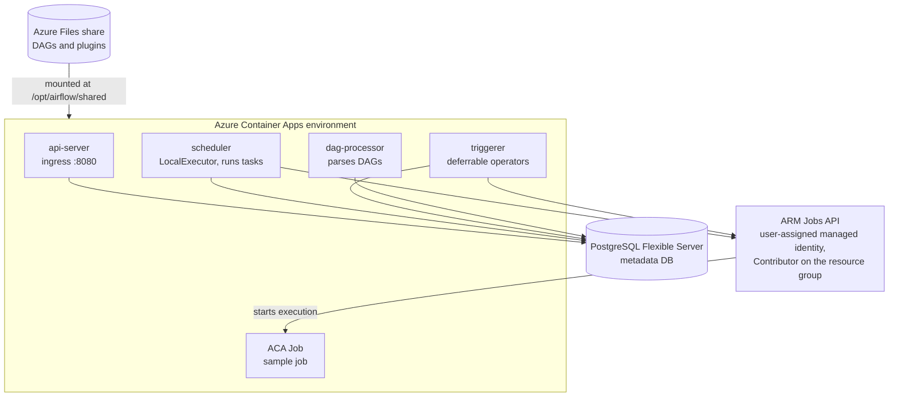
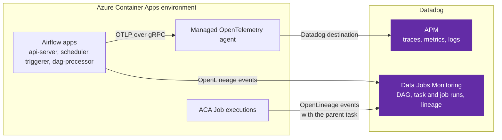

# Datadog for Airflow on Azure Container Apps

[](https://github.com/kyletaylored/airflow-aca-datadog/actions/workflows/ci.yml)

A working example of monitoring Apache Airflow 3 on Azure Container Apps (ACA) with
Datadog:

- **Data Jobs Monitoring** through OpenLineage: every DAG run, task, and the ACA
  Job runs those tasks launch, with dataset lineage.
- **APM** through OpenTelemetry and the ACA managed OTel agent: Airflow's own
  traces, metrics, and logs, plus a span for every Azure API call a task makes.

The Airflow-on-ACA deployment itself (the `azd` template, the ACA Jobs operator,
managed-identity auth) comes from
[hetvip2/airflow-hosted-on-aca](https://github.com/hetvip2/airflow-hosted-on-aca).
See that repo for the Airflow details. This repo adds the Datadog instrumentation
and demo DAGs that show it off.

**Contents:** [Architecture](#architecture) ·
[Minimum configuration](#minimum-configuration) ·
[DJM and APM compared](#data-jobs-monitoring-and-apm-compared) ·
[Airflow 2 and 3](#airflow-2-and-airflow-3-differences) ·
[Reference configuration](#reference-configuration) ·
[Deployment](#deployment) · [Known issues](#known-issues)

---

## Architecture

### Deployment



Four Airflow components run as container apps in one Container Apps environment.
They share a PostgreSQL metadata database and mount DAGs and plugins from an Azure
Files share. Tasks run on the scheduler (`LocalExecutor`). A task that uses the ACA
Jobs operator starts an execution of an ACA Job through the Azure Resource Manager
API, and the triggerer polls the execution while the task is deferred. Both
authenticate with the user-assigned managed identity.

### Telemetry to Datadog



Telemetry reaches Datadog by two independent paths:

- **APM:** every Airflow app exports OTLP to the environment's managed
  OpenTelemetry agent, which forwards traces, metrics and logs to Datadog.
- **Data Jobs Monitoring:** the OpenLineage listener on the scheduler, where tasks
  run, and each ACA Job execution post OpenLineage events straight to Datadog's
  intake. The agent isn't involved.

---

## Minimum configuration

There are two independent pieces, and each one is only environment variables. The
official `apache/airflow` 3.x image already includes the OpenLineage provider and
the OpenTelemetry SDK, so neither needs an install. **Start with Data Jobs
Monitoring:** on its own it gives you a trace per DAG run in Datadog.

| | Data Jobs Monitoring (OpenLineage) | APM (OpenTelemetry) |
|---|---|---|
| **You get** | Every DAG run and task run: status, duration, retries, failures, and dataset lineage. Also a trace per DAG run (DAG → tasks → jobs they launched). | Airflow's internals: the scheduler and the task process, plus calls tasks make (here, Azure ARM). Optionally Airflow metrics and logs carrying trace ids. |
| **Set it on** | Scheduler and wherever tasks run (workers; with `LocalExecutor`, the scheduler) | Each component you want to see |
| **Needs** | A Datadog API key | An OTLP endpoint that forwards to Datadog |

**Data Jobs Monitoring.** Set these four variables ([Datadog guide](https://docs.datadoghq.com/data_observability/jobs_monitoring/airflow/)):

```bash
OPENLINEAGE__TRANSPORT__TYPE=datadog
DD_API_KEY=<datadog-api-key>     # from a secret
DD_SITE=datadoghq.com            # your Datadog site
OPENLINEAGE_NAMESPACE=<env>      # shows up as the env tag
```

The `datadog` transport needs `apache-airflow-providers-openlineage` 2.7.3+ (the
3.x image's is newer). On an older provider, set
`OPENLINEAGE_URL=https://data-obs-intake.<site>` and `OPENLINEAGE_API_KEY=<key>`
instead of the first three.

**APM.** Turn on Airflow's native tracing and name each component:

```bash
AIRFLOW__TRACES__OTEL_ON=True
OTEL_SERVICE_NAME=airflow-scheduler                # per component
OTEL_RESOURCE_ATTRIBUTES=deployment.environment=<env>
```

Then give Airflow an OTLP endpoint:

- **On Azure Container Apps:** enable the environment's
  [managed OpenTelemetry agent](https://learn.microsoft.com/azure/container-apps/opentelemetry-agents)
  with a Datadog destination (site and API key). ACA injects the endpoint into every
  app. Don't set any `OTEL_EXPORTER_OTLP_*` variable yourself: if you set even one,
  ACA stops injecting all of them. Extend `OTEL_RESOURCE_ATTRIBUTES` as
  [Datadog's ACA managed-agent guide](https://docs.datadoghq.com/serverless/azure_container_apps/otel_managed_agent/)
  describes, so Datadog ties each service to its container app:
  `cloud.provider=azure,cloud.platform=azure.container_apps,cloud.resource_id=<app resource id>,cloud.region=<region>,deployment.environment.name=<env>,service.version=<version>`.
  Keep `deployment.environment=<env>` in the list too: the managed agent sets the
  Datadog `env` tag only from that key.
- **Anywhere else:** point `OTEL_EXPORTER_OTLP_ENDPOINT` at a Datadog Agent with
  OTLP ingest turned on (for example `http://<agent>:4317`).

Everything else in this repo is optional on top of that: Airflow metrics, logs,
Azure API spans, and ACA Jobs reporting their own runs.

---

## Data Jobs Monitoring and APM compared

They are not the same data. OpenLineage reports **what your pipelines did**: one
event when each DAG run, task run, or launched job starts and ends, with its status,
timing, configuration and datasets. OpenTelemetry reports **how Airflow did the
work**: fine-grained spans inside Airflow's own processes, plus Airflow's metrics and
logs. In Datadog, DJM's services are your DAGs (`contoso_sales`); APM's services are
Airflow components (`airflow-aca-scheduler`). They arrive as separate traces, so tie
them together by DAG ID, run ID and task ID.

| Question a pipeline owner asks | Data Jobs Monitoring (OpenLineage) | APM (OpenTelemetry) |
|---|---|---|
| Did last night's run succeed? Which task failed, and why? | ✅ Status of each DAG run and task, try number, error message and stack trace | Partly: errors on the task's span |
| Is it slower than usual, or late? | ✅ Run and task duration history per DAG, monitors on job status and duration | Task-process timing only |
| What did it read and write? What is downstream of a broken run? | ✅ Dataset lineage (from operators that report it, and from jobs like `contoso_store_job`) | ❌ |
| What did a task launch (ACA Job, Databricks, Spark), and how did that go? | ✅ Child job runs nested under the task, when the job reports its parent | ❌ (unless the job is OTel-instrumented too) |
| Which operator, owner, tags, params, schedule, run type? | ✅ Attached to every run as tags | Some, as span attributes |
| Where did the time go *inside* a task: queueing, the scheduler, an API call? | ❌ | ✅ Scheduler/worker/triggerer spans and HTTP client spans (here: each Azure ARM call, with latency and status code) |
| Is Airflow itself healthy (heartbeats, executor and pool slots, DAG parse time)? | ❌ | ✅ Airflow's OTel metrics |
| Task logs next to the run | When logs are collected with `source:airflow` | ✅ Logs carrying trace ids (this repo's log handler) |

**Rule of thumb:** the team that owns the DAGs starts with Data Jobs Monitoring,
because it is organized around DAGs and data. APM is for the team that runs
Airflow itself, or for when a slow task's cause sits inside Airflow or in the
services a task calls.

---

## Airflow 2 and Airflow 3 differences

This repo started on Airflow 2.10 and now runs 3.4. The Data Jobs Monitoring
setup is the same on both
([Datadog's Kubernetes tab](https://docs.datadoghq.com/data_observability/jobs_monitoring/airflow/?tab=kubernetes)
is what we followed, since ACA apps are configured the same way: env vars on the
scheduler and workers). The OpenTelemetry setup is where they differ.

| | Airflow 2 (2.7 to 2.10) | Airflow 3 |
|---|---|---|
| **OpenLineage provider** | Install and pin it on the scheduler and workers yourself (we used `apache-airflow-providers-openlineage==2.8.0`, Datadog's pick for 2.10). The `datadog` transport needs 2.7.3+. | Included in the official image (3.4.0 ships 2.21). Nothing to install. |
| **DJM variables** | The same four. On 2.7/2.8 with the `OPENLINEAGE_URL` form, also set `AIRFLOW__OPENLINEAGE__CONFIG_PATH=""` and `AIRFLOW__OPENLINEAGE__DISABLED_FOR_OPERATORS=""`. | The same four. |
| **Trace export** | Airflow's own OTel exports only to its `[traces] otel_host`/`otel_port` settings over OTLP/HTTP, and ignores the standard `OTEL_EXPORTER_OTLP_*` variables that ACA injects (gRPC). | Reads the standard `OTEL_EXPORTER_OTLP_*` variables and defaults to gRPC, so the endpoint ACA injects just works. |
| **Service name** | `AIRFLOW__TRACES__OTEL_SERVICE` | `OTEL_SERVICE_NAME` |
| **What it took on ACA** | Startup pip installs of the OTel SDK and instrumentations, running every component under `opentelemetry-instrument`, a gunicorn workaround for the webserver, and a custom plugin to build DAG-run traces (see this repo's history before commit `a1410cd`). | `AIRFLOW__TRACES__OTEL_ON=True` (and `AIRFLOW__METRICS__OTEL_ON=True` for metrics). |
| **Components** | webserver, scheduler, triggerer | api-server, scheduler, triggerer, dag-processor (each reports as its own service) |

If you are still on Airflow 2, start with Data Jobs Monitoring only. It needs just
the provider and four variables, and it already gives you a trace per DAG run.

---

## Reference configuration

Everything below is defined in [`infra/main.bicep`](infra/main.bicep) and turns on
when `DD_API_KEY` is set. Leave the key empty to deploy plain Airflow. The settings
live in five places:

| Location | What it holds | Defined in |
|---|---|---|
| Container Apps environment | The managed OTel agent and its Datadog destination | `openTelemetryConfiguration` on `managedEnvironment` |
| Container app env vars | Per-app settings. The API key comes from the app's `dd-api-key` secret | `datadogEnvVars`, `otelServiceEnv()`, `httpTracingEnv` |
| ACA Job template env | What every job execution starts with. The API key comes from the job's `dd-api-key` secret | `jobLineageEnv` on `sampleJob` |
| Job execution overrides | Values added to one execution when a task starts it | The operator plugin, at run time |
| Azure Files share | Plugin code that some variables point to | [`airflow/plugins/`](airflow/plugins) |

The Airflow apps are the api-server, scheduler, triggerer and dag-processor.

### Data Jobs Monitoring (OpenLineage) settings

Data Jobs Monitoring doesn't use the OTel agent. Each OpenLineage client posts
straight to `data-obs-intake.<site>`, so everything here is an environment variable.

| Variable | Value | Set on | Where it's set |
|---|---|---|---|
| `OPENLINEAGE__TRANSPORT__TYPE` | `datadog` | Airflow apps | Container app env var |
| `DD_API_KEY` | `dd-api-key` secret | Airflow apps, sample ACA Job | Container app or job secret, referenced by the env var (`secretRef`) |
| `DD_SITE` | `$DD_SITE` | Airflow apps, sample ACA Job | Container app env var, job template env |
| `OPENLINEAGE_NAMESPACE` | `$DD_ENV` (becomes the `env` tag) | Airflow apps, sample ACA Job | Container app env var, job template env |
| `OPENLINEAGE_PARENT_ID` | The task's run: `{namespace}/{dag_id}.{task_id}/{run_id}` | Each ACA Job execution | Job execution override, added by the operator |
| `OPENLINEAGE_ROOT_PARENT_ID` | The DAG run: `{namespace}/{dag_id}/{run_id}` | Each ACA Job execution | Job execution override, added by the operator |

Only the scheduler needs the first four variables, because tasks run there with
`LocalExecutor`. The other apps also get them because all four apps share one env
list. The ACA Job doesn't read `OPENLINEAGE__TRANSPORT__TYPE`: the demo job's own
code sends the events. Pass `pass_openlineage_parent=False` to the operator to stop
sending the two parent IDs.

### APM (OpenTelemetry) settings

**Container Apps environment (not environment variables).** The environment's
`openTelemetryConfiguration` gives the managed agent a Datadog destination (site
and API key). It routes traces to that destination, plus metrics and logs if
`TELEMETRY_SIGNALS` includes them. The agent can't read Key Vault or Container Apps
secrets, so the key is passed in as a secure deployment parameter and stored on the
environment.

**Injected by ACA.** ACA adds `OTEL_EXPORTER_OTLP_ENDPOINT` and
`OTEL_EXPORTER_OTLP_PROTOCOL` (gRPC) to every app and job, pointing at the agent.
They aren't in the Bicep. Don't set either one yourself (see
[Known issues](#known-issues)).

**Container app env vars:**

| Variable | Value | Set on | For |
|---|---|---|---|
| `AIRFLOW__TRACES__OTEL_ON` | `True` | Airflow apps | Traces |
| `AIRFLOW__METRICS__OTEL_ON` | `True` | Airflow apps, when metrics are on | Metrics |
| `AIRFLOW__LOGGING__LOGGING_CONFIG_CLASS` | `otel_logging_config.LOGGING_CONFIG` | Airflow apps, when logs are on | Logs. The handler is plugin code on the Azure Files share |
| `OTEL_TRACES_EXPORTER`, `OTEL_METRICS_EXPORTER`, `OTEL_LOGS_EXPORTER` | `otlp`, or `none` for a signal that's turned off | Airflow apps | Which signals to send |
| `OTEL_SERVICE_NAME` | `airflow-aca-<component>` | Each app, with its own value | One service per component |
| `OTEL_RESOURCE_ATTRIBUTES` | `cloud.provider`, `cloud.platform`, `cloud.resource_id`, `cloud.region`, `deployment.environment`, `deployment.environment.name`, `service.version`, `service.namespace` | Each app, with its own value | Ties each service to its container app |
| `_PIP_ADDITIONAL_REQUIREMENTS` | `opentelemetry-instrumentation-requests==0.66b2` | Scheduler, triggerer | Azure API spans |

The sample ACA Job sends no OpenTelemetry. ACA injects the endpoint into it too, but
the job's code doesn't use it.

### Additional instrumentation

- **Logs.** Airflow has no native OTel logs, so
  [`plugins/otel_logging_config.py`](airflow/plugins/otel_logging_config.py) adds an
  OTLP log handler to Airflow's logging config. Records emitted inside a span carry
  its trace id, so Datadog links logs and traces.
- **Azure API spans.** The scheduler and triggerer install
  `opentelemetry-instrumentation-requests` at startup (`_PIP_ADDITIONAL_REQUIREMENTS`,
  pinned to the image's OTel SDK), and the operator plugin turns it on. Each ARM call
  (start the job, poll its execution) and managed-identity token fetch becomes a
  client span under the task's `worker.*` / `trigger.*` span, with resources like
  `POST Microsoft.App/jobs/{job}/start`. For production, bake the package into a
  custom image instead.
- **ACA Job runs nested under the task that started them.** `OPENLINEAGE_PARENT_ID`
  and `OPENLINEAGE_ROOT_PARENT_ID` use the same format dbt-ol reads. A job that sends
  its own OpenLineage START and COMPLETE events with those IDs as its parent shows
  up in Datadog under that Airflow task, the way Databricks runs do. Its datasets
  also join the lineage graph.
  [`airflow/dags/jobs/contoso_store_job.py`](airflow/dags/jobs/contoso_store_job.py)
  is an example that uses only the standard library. In your own job, the
  `openlineage-python` client with `OPENLINEAGE__TRANSPORT__TYPE=datadog` does the
  same thing.

---

## Demo DAGs

| DAG | Shows |
|---|---|
| `contoso_sales` | The main demo. Fans out one ACA Job run per store, gates on every store reporting, then rolls up a company total. Each job run reports its own lineage, so DJM shows the store runs nested under their tasks and lineage from each store's sales dataset into the total. Trigger with `{"chaos": true}` to make one store fail once and recover on retry. |
| `aca_jobs_pipeline` | Parallel fan-out of N shards over the sample job. |
| `aca_jobs_example` | A single ACA Job run with overrides. |

All three run every 5 minutes by default (`DEMO_DAG_SCHEDULE`), so Datadog has data
shortly after the deploy.

---

## Deployment

You need the [Azure Developer CLI](https://learn.microsoft.com/azure/developer/azure-developer-cli/install-azd),
the [Azure CLI](https://learn.microsoft.com/cli/azure/install-azure-cli), an Azure
subscription, and a Datadog API key.

```bash
azd env new airflow-datadog

azd env set POSTGRES_ADMIN_PASSWORD "Pg1-$(openssl rand -hex 16)"
azd env set AIRFLOW_ADMIN_PASSWORD  "$(openssl rand -base64 18)"
azd env set AIRFLOW_SECRET_KEY      "$(openssl rand -hex 32)"

azd env set DD_API_KEY "<your-datadog-api-key>"
azd env set DD_SITE    "datadoghq.com"     # your Datadog site
azd env set DD_ENV     "airflow-aca"       # env tag and OpenLineage namespace

azd up
```

`azd up` provisions everything, then its postprovision hook uploads `airflow/dags`
and `airflow/plugins` to the Azure Files share the apps mount. After editing DAGs or
plugins, run `azd hooks run postprovision` again; Airflow picks them up within a
minute.

The deploy assigns the Airflow managed identity a role on the resource group,
which needs Owner or User Access Administrator. With only Contributor, set
`azd env set ASSIGN_JOBS_ROLE false` and have an admin run the printed
`grantRoleCommand` (details in the
[source repo](https://github.com/hetvip2/airflow-hosted-on-aca#permissions--role-assignment)).

| azd env variable | Default | Purpose |
| --- | --- | --- |
| `DD_API_KEY` | _(empty)_ | Datadog API key. Setting it turns on everything above |
| `DD_SITE` | `datadoghq.com` | Datadog site (`us3.datadoghq.com`, `datadoghq.eu`, `ap1.datadoghq.com`, …) |
| `DD_ENV` | `airflow-aca` | Datadog `env` tag and the OpenLineage namespace |
| `TELEMETRY_SIGNALS` | `traces,metrics,logs` | This repo's setting (not a Datadog or OTel variable): which OTel signals Airflow emits and the agent forwards |
| `DEMO_DAG_SCHEDULE` | `*/5 * * * *` | Schedule for the demo DAGs (empty string for manual-only) |
| `RESOURCE_TAGS` | _(empty)_ | Extra tags on every resource, e.g. `team=data,owner=me` |
| `ASSIGN_JOBS_ROLE` | `true` | `false` skips the managed identity's role assignment |
| `AZURE_LOCATION`, `NAME_PREFIX`, `POSTGRES_*`, `AIRFLOW_ADMIN_*`, `AIRFLOW_SECRET_KEY` | | Airflow deployment settings; see [`infra/main.parameters.json`](infra/main.parameters.json) and the [source repo](https://github.com/hetvip2/airflow-hosted-on-aca#configurable-parameters) |

---

## Known issues

- **Setting one `OTEL_EXPORTER_OTLP_*` variable turns off ACA's injection.** ACA
  injects the agent's endpoint and protocol only when an app defines none of them.
  Setting just `OTEL_EXPORTER_OTLP_PROTOCOL=grpc` left every app without an
  endpoint, and nothing was exported.
- **`env:none` on spans.** The managed agent maps Datadog `env` only from
  `deployment.environment`, not from `deployment.environment.name` alone. Set both.
- **OpenLineage's own HTTP calls.** With `requests` instrumentation on, the
  OpenLineage transport's POSTs to `data-obs-intake.*` would each become a stray
  single-span trace (its listener runs outside the task span), so the plugin
  excludes that host.
- **ARM `403 The request is blocked`.** Consumption ACA environments share outbound
  IPs, and ARM's edge once blocked the one the scheduler used. A new revision moved
  it to another IP. If you need a stable outbound IP, put the environment on a VNet
  with a NAT gateway.
- **Manually triggered Airflow 3 runs have no logical date**, so `ds` is missing
  from the task context. The demo DAG falls back to the run's `run_after` date.

---

## Repository layout

```
├─ airflow/
│  ├─ dags/                 # contoso_sales, aca_jobs_pipeline, aca_jobs_example
│  │  └─ jobs/              # code the contoso_sales ACA Jobs run (reports OpenLineage)
│  └─ plugins/
│     ├─ operators/         # ACA Jobs operator, ARM helpers, requests instrumentation
│     ├─ triggers/          # async trigger for deferrable execution
│     └─ otel_logging_config.py  # OTLP log handler for Airflow's logging
├─ infra/main.bicep         # ACA environment + managed OTel agent, Airflow apps, sample job
├─ scripts/upload-dags.*    # postprovision: upload DAGs and plugins to the share
└─ tests/                   # offline unit tests (no Azure, no Datadog)
```

The `Dockerfile` and `docker-compose.yml` local stack come from the source repo
and still run Airflow 2.10 without Datadog.

## Testing

```bash
pip install -e ".[test]"
pytest
```

CI runs the tests and checks that the Bicep compiles.

## License and attribution

Apache-2.0, see [LICENSE](LICENSE). This project is derived from
[hetvip2/airflow-hosted-on-aca](https://github.com/hetvip2/airflow-hosted-on-aca)
(Copyright (c) Microsoft Corporation), which provides the Airflow-on-ACA template,
operator, and trigger.
