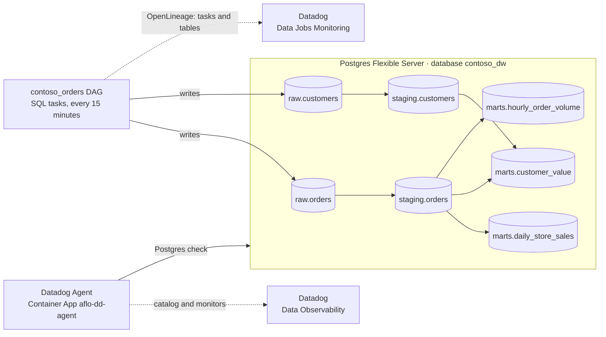

# Data pipeline demo: Postgres medallion with Data Observability

This is an optional add-on to the main [Datadog for Airflow on ACA](../README.md)
setup. It gives the OpenLineage and OpenTelemetry instrumentation a realistic
workload:

- **Data Jobs Monitoring** shows the DAG with table-level lineage.
- **Data Observability** shows the same tables in its catalog and runs data quality
  monitors on them.

The pipeline doesn't change how Airflow is instrumented.



## What it adds

Everything below is created only when the pipeline is turned on, with
`enableDataPipeline` in [`infra/main.bicep`](../infra/main.bicep).

| Piece | What it is |
|---|---|
| `contoso_dw` database | On the existing Postgres server, next to Airflow's `airflow` database. It holds the `raw`, `staging` and `marts` schemas (bronze, silver, gold). |
| `contoso_dw_bootstrap` DAG | Runs once after the deploy. It creates the schemas and tables, seeds 2,000 customers, and creates the read-only `datadog` role that Datadog's [PostgreSQL setup](https://docs.datadoghq.com/data_observability/quality_monitoring/transactional_databases/postgres/) asks for. The statements run on a raw cursor, so the role's password never reaches task logs or OpenLineage. |
| `contoso_orders` DAG | Every 15 minutes: load 200 to 400 orders into `raw`, rebuild `staging`, check it, then rebuild three marts. |
| `aflo-dd-agent` Container App | A Datadog Agent (7.81 or later) running the Postgres check with `data_observability.enabled`. One replica only, so each monitor runs once. |

### How Airflow gets the warehouse

`AIRFLOW_CONN_CONTOSO_DW` holds the `contoso_dw` connection, and both DAGs exist only
when it's set.

The connection's host must be the server's FQDN. OpenLineage's Postgres naming is
namespace `postgres://{host}:{port}` and name `{database}.{schema}.{table}`, and the
Agent's check uses the same host. That way, Data Jobs Monitoring and the Data
Observability catalog refer to the same tables.

### How the Agent is set up

The Agent writes its Postgres check config from environment variables at startup,
so the password stays in a Container Apps secret. The Agent has internal ingress on
port 8126, which is the trace intake for services instrumented with dd-trace.
Airflow keeps using the managed OTel agent.

## Lineage

Every task is SQL run with `SQLExecuteQueryOperator` (or `SQLCheckOperator`), so
OpenLineage reads the tables from the statements. Nothing reports lineage by hand.

| Task | Reads | Writes |
|---|---|---|
| `ingest_orders` | | `raw.orders` |
| `ingest_customers` | | `raw.customers` |
| `staging_orders` | `raw.orders` | `staging.orders` |
| `staging_customers` | `raw.customers` | `staging.customers` |
| `check_staging` | `staging.orders` | |
| `mart_daily_store_sales` | `staging.orders` | `marts.daily_store_sales` |
| `mart_customer_value` | `staging.orders`, `staging.customers` | `marts.customer_value` |
| `mart_hourly_order_volume` | `staging.orders` | `marts.hourly_order_volume` |

[`tests/test_contoso_dw.py`](../tests/test_contoso_dw.py) checks this table with
`openlineage-sql`, the parser Airflow's OpenLineage provider uses.

## Turn it on

You need:

- **Datadog Data Observability for PostgreSQL.** It's in Preview, so your Datadog
  rep enables it for the org.
- **Remote Configuration**, on the org and on the API key in `DD_API_KEY`. The
  monitors reach the Agent through it.

```bash
azd env set ENABLE_DATA_PIPELINE true
azd env set DD_POSTGRES_PASSWORD "$(openssl rand -hex 24)"
azd provision
```

For the [deploy workflow](../README.md#continuous-deployment), add the same two
settings to the `azure` GitHub environment. Without them, the next infra deploy
turns the pipeline off. The workflow refuses to run if `ENABLE_DATA_PIPELINE` is set
but its password isn't.

```bash
gh variable set ENABLE_DATA_PIPELINE --env azure --repo "$REPO" --body true
azd env get-value DD_POSTGRES_PASSWORD | gh secret set DD_POSTGRES_PASSWORD --env azure --repo "$REPO"
```

## Check that it works

1. **The Agent sees the database and Remote Configuration.** Run the status command
   inside the Agent:

   ```bash
   az containerapp exec -g <rg> -n aflo-dd-agent --command "agent status"
   ```

   - In **Collector**, the `postgres` check shows `Total Runs` above zero, with no
     error.
   - In **Remote Configuration**, the status shows `Organization enabled: True` and
     `API Key: Authorized`.
2. **The tables are in the catalog.** Open Data Observability → Catalog, filtered to
   PostgreSQL. All seven tables should be listed under the server's FQDN. In our
   deploy they showed up within minutes, but Datadog says to allow up to an hour.
3. **Lineage connects.** Anchor the lineage graph on `raw.customers` or
   `raw.orders`. The `contoso_orders` tasks should sit between the `raw`, `staging` and
   `marts` tables, with column-level edges: for example,
   `raw.customers` → `staging_customers` → `staging.customers` →
   `mart_customer_value` → `marts.customer_value`. Each table is a single entity that
   both the Agent and Airflow's OpenLineage events report on.

## Monitors to create

Create these from a table's **Monitors** tab, under Add Monitor:

| Table | Monitor | What it catches |
|---|---|---|
| `raw.orders` | Row count | `volume_drop` and `skip_load` |
| `staging.orders` | Column metric: null ratio of `customer_id` | `null_customers` |
| `staging.orders` | Custom SQL (freshness, in minutes): `SELECT EXTRACT(EPOCH FROM now() - max(ordered_at)) / 60 AS dd_value FROM staging.orders` | `skip_load` |
| `marts.daily_store_sales` | Custom SQL: `SELECT count(*) AS dd_value FROM marts.daily_store_sales WHERE revenue_usd < 0` (alert above 0) | Bad amounts that get past the checks |

Schema changes on `raw.orders` (`schema_drift`) show up on the table's **Schema
Changes** tab.

## Break it on purpose

Trigger `contoso_orders` with a config. In the UI, use **Trigger DAG** and edit the
params. From a shell:

```bash
az containerapp exec -g <rg> -n aflo-scheduler \
  --command 'airflow dags trigger contoso_orders -c {"null_customers":true}'
```

| Param | Effect |
|---|---|
| `null_customers` | 30% of orders have no `customer_id`. `staging.orders` carries the nulls, and `marts.customer_value` loses those orders, because it joins on the customer. |
| `volume_drop` | Only 5% of the usual orders land. |
| `skip_load` | No orders land, so `staging.orders` goes stale. |
| `schema_drift` | `raw.orders` gains a `promo_code` column. A normal run drops it again. |
| `interval_minutes` | The window the order timestamps fall in (default 15). |

Scheduled runs use the defaults, so the data recovers on the next scheduled run,
about 15 minutes later.

## Cost

The Agent app (0.5 vCPU, 1 GiB, always on) adds roughly $25–35 a month. The
database uses the existing Postgres server; `raw.orders` keeps 14 days of orders,
about 400k rows.
