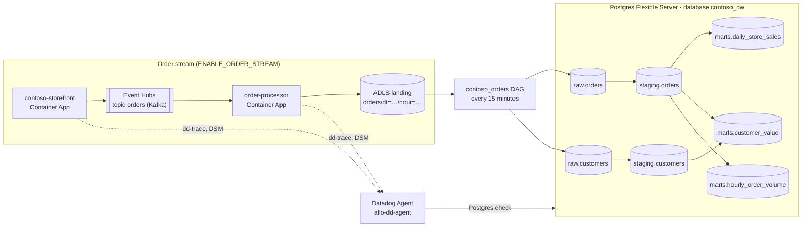

# Data pipeline demo: order stream to Postgres medallion, with Data Observability

This is an optional add-on to the main [Datadog for Airflow on ACA](../README.md) setup. It gives the OpenLineage and OpenTelemetry instrumentation a realistic workload: orders flow from a storefront, through Event Hubs and a landing zone, into a Postgres medallion that Airflow builds.

## The story

Contoso Outfitters is a global e-commerce retailer of outdoor and travel gear. It sells through its website, its mobile app and its own stores. This demo follows its North American business: seven stores and about 2,000 customers.

Every order the storefront takes goes onto Azure Event Hubs. An order processor lands the orders in batches in Azure Data Lake Storage. Apache Airflow, running on Azure Container Apps, loads them every 15 minutes into a Postgres warehouse: `raw`, then cleaned `staging` tables, then `marts` tables for reporting. Datadog watches each step: APM and Data Streams Monitoring for the services, Data Jobs Monitoring for Airflow, and Data Observability for the tables and their lineage.

Five people run this pipeline:

| Person | Role | Owns |
|---|---|---|
| Dave | Application engineer | The storefront and the order processor, up to the files in the landing zone |
| Rajesh | Data architect | The warehouse design: the schemas and tables, and what each column means |
| Emily | Data engineer | The Airflow pipelines that move data from the landing zone through `raw` and `staging` |
| Priya | Analytics engineer | The `marts` transformations: the SQL that turns clean orders into business metrics |
| John | BI lead | The reports built on the `marts` tables, and the people who read them |

Each of them has a scenario, in [Demo scenarios](#demo-scenarios): something breaks in their part of the pipeline, Datadog alerts, and they find the cause.

## What Datadog shows

- **Data Jobs Monitoring** shows the DAG with table-level lineage.
- **Data Observability** shows the same tables in its catalog, runs data quality monitors on them, and joins the lineage from the Kafka topic to the marts.
- **Data Streams Monitoring** shows the storefront → `orders` → order-processor pathway.
- **Database Monitoring** shows the whole Postgres server: query metrics, samples and explain plans for Airflow's own metadata queries and the pipeline's SQL, plus each database's schemas.

The pipeline doesn't change how Airflow is instrumented. It has two layers, each behind its own switch:

| Switch | Adds |
|---|---|
| `ENABLE_DATA_PIPELINE` | The `contoso_dw` warehouse database, its DAGs, and a Datadog Agent with Data Observability and Database Monitoring for PostgreSQL. On its own, the DAG makes up its orders. |
| `ENABLE_ORDER_STREAM` | The storefront, Event Hubs, the order processor and the ADLS landing zone. The DAG then loads the landed orders instead. It needs `ENABLE_DATA_PIPELINE`. |



## What it adds

### The warehouse (`ENABLE_DATA_PIPELINE`)

| Piece | What it is |
|---|---|
| `contoso_dw` database | On the existing Postgres server, next to Airflow's `airflow` database. It holds the `raw`, `staging` and `marts` schemas (bronze, silver, gold). |
| `contoso_dw_bootstrap` DAG | Runs once after the deploy. It creates the schemas and tables, seeds 2,000 customers, and creates the read-only `datadog` role that Datadog's [PostgreSQL setup](https://docs.datadoghq.com/data_observability/quality_monitoring/transactional_databases/postgres/) asks for. The statements run on a raw cursor, so the role's password never reaches task logs or OpenLineage. |
| `contoso_orders` DAG | Every 15 minutes: load orders into `raw`, rebuild `staging`, check it, then rebuild three marts. |
| `aflo-dd-agent` Container App | A Datadog Agent (7.81 or later) running the Postgres check with `data_observability.enabled` and `dbm: true`. One replica only, so each monitor runs once. It's also the trace intake for the two stream services. |
| Postgres server settings | What [Database Monitoring for Azure](https://docs.datadoghq.com/database_monitoring/setup_postgres/azure/) asks for on Flexible Server: `pg_stat_statements` on `azure.extensions`, `pg_stat_statements.track=ALL`, `pg_stat_statements.max=10000`, `pg_stat_statements.track_utility=off`, `track_activity_query_size=4096` and `track_io_timing=on`. Azure already preloads `pg_stat_statements`. |

**How Airflow gets the warehouse.** `AIRFLOW_CONN_CONTOSO_DW` holds the `contoso_dw` connection, and both DAGs exist only when it's set. The connection's host must be the server's FQDN. OpenLineage names Postgres tables with namespace `postgres://{host}:{port}` and name `{database}.{schema}.{table}`, and the Agent's check uses the same host. That way, Data Jobs Monitoring and the Data Observability catalog refer to the same tables.

**How the Agent is set up.** The Agent writes its Postgres check config from environment variables at startup, so the password stays in a Container Apps secret. It has internal HTTP ingress on port 8126, which the stream services reach at `http://aflo-dd-agent`. Airflow keeps using the managed OTel agent.

**How Database Monitoring is set up.** One Postgres check instance does both jobs. It has `dbm: true`, `collect_schemas` and relation metrics for every table, and `database_autodiscovery`, so it covers `airflow`, `contoso_dw`, `metabase` and `postgres` (not Azure's `azure_maintenance` and `azure_sys`). Its `azure` block (`deployment_type: flexible_server`) links the instance to the Azure resource when Datadog's Azure integration is set up. `contoso_dw_bootstrap` gives each of those databases the `datadog` schema, the `datadog.explain_statement` function and the `pg_stat_statements` extension. The role gets `pg_monitor`, which includes the `pg_read_all_settings` and `pg_read_all_stats` that DBM's Postgres 16 setup grants. Database Monitoring's schemas cover every database. So does Data Observability's catalog: besides `contoso_dw`, it lists Airflow's and Metabase's internal tables and Azure's `azure_sys`, though the `datadog` role can't `SELECT` from them. Limiting `collect_schemas` to `contoso_dw` doesn't change that, so filter the catalog to `contoso_dw` in Datadog.

Two of the server settings, `track_activity_query_size` and `pg_stat_statements.max`, only apply after Postgres restarts, which Bicep doesn't do. The deploy workflow restarts the server when Azure reports a setting waiting for one, which happens once, on the first deploy that sets them. Airflow loses its database for a minute or two. After `azd provision` from your machine, restart it yourself:

```bash
az postgres flexible-server restart -g <rg> -n "$(azd env get-value postgresServerName)"
```

### The order stream (`ENABLE_ORDER_STREAM`)

| Piece | What it is |
|---|---|
| `aflo-storefront` Container App | [`services/storefront.py`](../services/storefront.py) produces about 20 orders a minute (`storefrontOrdersPerMinute`) to the `orders` topic. |
| Event Hubs namespace | Standard tier with one event hub, `orders` (2 partitions, 1 day of retention), used through its Kafka endpoint. Basic has no Kafka endpoint. |
| `aflo-order-processor` Container App | [`services/order_processor.py`](../services/order_processor.py) consumes `orders`, drops messages that aren't valid orders, and every 5 minutes writes a newline-delimited JSON batch to the landing zone. It commits its Kafka offsets only after the blob is written. |
| `stdl…` storage account | A small ADLS Gen2 account (hierarchical namespace) with the `landing` container. It's separate from the Airflow file share's account, so the `abfss://` names in lineage describe it accurately. |

Both services run the stock `python:3.12-slim` image. They install their packages at startup and run code from the Airflow file share (`services/`), so there's no image to build. The deploy workflow uploads `services/` when it changes, and restarts both apps if `ENABLE_ORDER_STREAM` is `true` on the `azure` environment.

**Why these two use dd-trace instead of OpenTelemetry.** Data Streams Monitoring needs a Datadog SDK; OpenTelemetry can't produce DSM pathways. So the storefront and the processor run under `ddtrace-run` with `DD_DATA_STREAMS_ENABLED=true`, and send to the pipeline's Agent. This is the only part of the repo that uses a Datadog SDK. For Source Code Integration they get `DD_GIT_REPOSITORY_URL` and `DD_GIT_COMMIT_SHA` (the Airflow apps get the same as OpenTelemetry resource attributes, under both the `vcs.*` and the `git.*` names). When only their code changes, the deploy workflow sets the new commit, which restarts them on a new revision. For open-source languages, DSM supports Kafka and RabbitMQ (Azure Service Bus only from .NET), which is why the stream uses Event Hubs' Kafka endpoint.

### Metabase (`ENABLE_METABASE`)

John's dashboards, on the marts. With Datadog's [Metabase integration](https://docs.datadoghq.com/integrations/metabase/) they appear in lineage below the `marts` tables, so an affected table leads straight to the dashboards that show its numbers.

| Piece | What it is |
|---|---|
| `aflo-metabase` Container App | Metabase, the open-source edition (1 vCPU, 2 GiB). It scales to zero, so the first request after a quiet spell takes about a minute. Datadog's crawl wakes it too. |
| `metabase` database | On the same Postgres server. Metabase keeps its questions, dashboards and users there. |
| `metabase` Postgres role | Created by `contoso_dw_bootstrap`. It owns the `metabase` database and can read `contoso_dw.marts`, nothing else. |
| [`metabase/dashboards.json`](../metabase/dashboards.json) | The three dashboards and their 19 questions: "Store Sales — Today", "Customer Value" and "Pipeline Health". [`scripts/metabase_seed.py`](../scripts/metabase_seed.py) creates them. |

The open-source edition is enough for lineage. The integration's usage analytics (who views what) read Metabase's internal usage database, which only Pro and Enterprise have, so that part stays empty.

Metabase needs more connections than `Standard_B1ms` allows. B1ms caps `max_connections` at 50, and 15 of those are reserved. Run the server on `Standard_B2s` with `max_connections` at 200. Its connection pools are capped at 4 for its own database and 3 for the warehouse.

## Lineage

| Task or job | Reads | Writes | How it's reported |
|---|---|---|---|
| `order_processor.land_orders` | `kafka://<namespace>.servicebus.windows.net:9093` `orders` | `abfss://landing@<account>.dfs.core.windows.net` `orders` | The processor sends an OpenLineage run per batch, with the row count |
| `ingest_orders` (stream mode) | the landing zone | `raw.orders` | `LoadLandedOrdersOperator.get_openlineage_facets_on_complete` |
| `ingest_orders` (no stream) | | `raw.orders` | SQL |
| `ingest_customers` | | `raw.customers` | SQL |
| `staging_orders` | `raw.orders` | `staging.orders` | SQL |
| `staging_customers` | `raw.customers` | `staging.customers` | SQL |
| `check_staging` | `staging.orders` | | SQL |
| `mart_daily_store_sales` | `staging.orders` | `marts.daily_store_sales` | SQL |
| `mart_customer_value` | `staging.orders`, `staging.customers` | `marts.customer_value` | SQL |
| `mart_hourly_order_volume` | `staging.orders` | `marts.hourly_order_volume` | SQL |

"SQL" means `SQLExecuteQueryOperator` (or `SQLCheckOperator`): OpenLineage reads the tables from the statements, with column-level lineage. The stream-mode load is Python, so its operator reports its datasets itself, using the same names as the processor and the Postgres provider.

[`tests/test_contoso_dw.py`](../tests/test_contoso_dw.py) checks the SQL rows with `openlineage-sql`, the parser Airflow's OpenLineage provider uses. It checks both the tables and the column names.

In the SQL, give every SELECT column an alias that matches its INSERT target. The parser names column lineage after the SELECT output and ignores the INSERT column list, so an unaliased expression such as `round(amount_cents / 100.0, 2)` shows up as `_0`, and the lineage stops there. [`tests/test_contoso_stream.py`](../tests/test_contoso_stream.py) checks that the processor and the DAG name the landing zone the same way.

## Turn it on

You need:

- **Datadog Data Observability for PostgreSQL.** It's in Preview, so your Datadog rep enables it for the org.
- **Remote Configuration**, on the org and on the API key in `DD_API_KEY`. The monitors reach the Agent through it.

```bash
azd env set ENABLE_DATA_PIPELINE true
azd env set DD_POSTGRES_PASSWORD "$(openssl rand -hex 24)"
azd env set ENABLE_ORDER_STREAM true     # optional: the storefront and Event Hubs
azd provision
```

On the very first provision with the stream on, the two services can start before the postprovision hook has uploaded their code, and exit. Restart them once the hook finishes:

```bash
for app in aflo-storefront aflo-order-processor; do
  az containerapp revision restart -g <rg> -n "$app" \
    --revision "$(az containerapp show -g <rg> -n "$app" --query properties.latestRevisionName -o tsv)"
done
```

For the [deploy workflow](continuous-deployment.md), add the same settings to the `azure` GitHub environment. Without them, the next infra deploy turns them off. The workflow refuses to run if `ENABLE_DATA_PIPELINE` is set but its password isn't.

```bash
gh variable set ENABLE_DATA_PIPELINE --env azure --repo "$REPO" --body true
gh variable set ENABLE_ORDER_STREAM --env azure --repo "$REPO" --body true
azd env get-value DD_POSTGRES_PASSWORD | gh secret set DD_POSTGRES_PASSWORD --env azure --repo "$REPO"
```

### Metabase

Turn it on with a bigger Postgres server:

```bash
azd env set ENABLE_METABASE true
azd env set METABASE_DB_PASSWORD "$(openssl rand -hex 24)"
azd env set POSTGRES_SKU_NAME Standard_B2s
azd env set POSTGRES_MAX_CONNECTIONS 200
azd provision
```

`contoso_dw_bootstrap` creates the `metabase` role, and Metabase restarts until it exists. On an existing deployment the bootstrap has already run, so trigger it again once the provision finishes.

Then create the dashboards. On a new Metabase, the script also creates the admin user with the email and password you give it:

```bash
export METABASE_URL="$(azd env get-value metabaseUrl)"
export METABASE_ADMIN_EMAIL=you@example.com
export METABASE_ADMIN_PASSWORD='choose-one'
export METABASE_DB_PASSWORD="$(azd env get-value METABASE_DB_PASSWORD)"
export CONTOSO_DW_HOST="$(az postgres flexible-server list -g <rg> --query '[0].fullyQualifiedDomainName' -o tsv)"
python3 scripts/metabase_seed.py seed
```

It connects `contoso_dw` as the `metabase` role (the `marts` schema only), and creates the "Contoso Demo" collection with the three dashboards. It skips anything that already exists. After you change the dashboards in Metabase, run `python3 scripts/metabase_seed.py export` to write them back to `metabase/dashboards.json`.

Last, connect Datadog. In Metabase, create an API key (Admin settings → Authentication → API keys) in the Administrators group. In Datadog, open the Metabase integration tile and add the Metabase URL and that key. The dashboards show in lineage after Datadog's next crawl.

For the deploy workflow:

```bash
gh variable set ENABLE_METABASE --env azure --repo "$REPO" --body true
gh variable set POSTGRES_SKU_NAME --env azure --repo "$REPO" --body Standard_B2s
gh variable set POSTGRES_MAX_CONNECTIONS --env azure --repo "$REPO" --body 200
azd env get-value METABASE_DB_PASSWORD | gh secret set METABASE_DB_PASSWORD --env azure --repo "$REPO"
```

## Check that it works

1. **The Agent sees the database and Remote Configuration.** Run the status command inside the Agent:

   ```bash
   az containerapp exec -g <rg> -n aflo-dd-agent --command "agent status"
   ```

   - In **Collector**, the `postgres` check shows `Total Runs` above zero, with no error.
   - In **Remote Configuration**, the status shows `Organization enabled: True` and `API Key: Authorized`.
2. **Database Monitoring sees every database.** In the same status output, the `postgres` check lists the databases it discovered. In Datadog, open Database Monitoring → Databases: the server's FQDN shows query metrics and samples, the Explain Plans tab fills in for the pipeline's queries, and the Schemas tab lists the tables of `airflow`, `contoso_dw` and `metabase`. If query metrics stay empty, check that `pg_stat_statements.track` is `ALL` and that the restart above ran:

   ```bash
   az postgres flexible-server parameter list -g <rg> -s "$(azd env get-value postgresServerName)" \
     --query "[?isConfigPendingRestart].name"
   ```

   An existing deployment also needs `contoso_dw_bootstrap` triggered once more after the deploy, so it adds the DBM schema and function to each database.
3. **The tables are in the catalog.** Open Data Observability → Catalog, filtered to PostgreSQL and the `contoso_dw` database (the catalog also lists the server's other databases). All the tables should be listed under the server's FQDN. In our deploy they showed up within minutes, but Datadog says to allow up to an hour.
4. **Lineage connects.** Anchor the lineage graph on `raw.orders`. The `contoso_orders` tasks should sit between the `raw`, `staging` and `marts` tables, with column-level edges. Each table is a single entity that both the Agent and Airflow's OpenLineage events report on. With the stream on, `raw.orders` has `ingest_orders`, then the landing zone's `orders` dataset, then the `orders` Kafka topic upstream of it. Datadog draws the processor's batches as the edge from the topic to the landing zone.

   The topic currently appears twice. Data Streams Monitoring reports one `orders` topic, with `contoso-storefront` producing to it. The processor's OpenLineage events report another, which feeds the landing zone. Datadog doesn't merge the two yet.
5. **The stream flows.** APM shows `contoso-storefront` (`kafka.produce`) and `order-processor` (`kafka.consume`), and Data Streams Monitoring shows the pathway between them through `orders`. The processor's log prints `landed N orders in orders/dt=…`.

## Monitors to create

These are the eight monitors the scenarios use, as we set them up and tested them on 2026-11-16. Three things decide whether a monitor works at all:

- **Publish it.** A monitor saved as a draft (Save as draft in the UI, or `"draft_status": "draft"` from the API) is never scheduled on the Agent, so its query never runs and it stays at No Data. Every "No Data" monitor in our deploy was a draft.
- **Give it a schedule.** Without one, Custom SQL and column monitors run once when they're created. Use the custom cron `5,20,35,50 * * * *`: `contoso_orders` runs every 15 minutes and takes about 2, so each check lands just after a run.
- **Measure a recent window.** `raw.orders` keeps 14 days of orders, about 400,000 rows, so one bad batch barely moves a whole-table row count or null ratio. Filter the measure to the last hour or the last run, with the check's WHERE clause (`custom_where` in the API).

Create these from a table's **Monitors** tab, under Add Monitor:

| Table | Monitor | Alert when | What it catches |
|---|---|---|---|
| `raw.orders` | Row Count, WHERE `_loaded_at > now() - interval '15 minutes'`: the rows the latest run loaded | below 100 (healthy is about 200 to 500) | a stopped load, and `volume_drop` |
| `staging.orders.customer_id` | Null ratio (Nullness), WHERE `ordered_at > now() - interval '1 hour'`. The measure is a percentage, 0 to 100 | above 1 (healthy is 0) | `null_customers`, which reads about 5 to 6% after one run |
| `staging.orders` | Custom SQL freshness, in minutes: `SELECT EXTRACT(EPOCH FROM now() - max(ordered_at)) / 60 AS dd_value FROM staging.orders` | above 45 (healthy is about 5 to 25) | a stopped load |
| `marts.daily_store_sales` | Custom SQL: `SELECT count(*) AS dd_value FROM marts.daily_store_sales WHERE revenue_usd < 0` | above 0 | `refund_bug` |
| `marts.daily_store_sales` | Custom SQL freshness: `SELECT EXTRACT(EPOCH FROM now() - max(updated_at)) / 60 AS dd_value FROM marts.daily_store_sales` | above 45 | a failed or stopped DAG |
| `marts.daily_store_sales` | Custom SQL, revenue for the last 7 complete days: `SELECT coalesce(sum(revenue_usd), 0) AS dd_value FROM marts.daily_store_sales WHERE sales_date >= (now() AT TIME ZONE 'UTC')::date - 7 AND sales_date < (now() AT TIME ZONE 'UTC')::date`. Don't measure today's revenue: it restarts from 0 at midnight UTC, so early in the day a drop falls inside the expected range | anomaly detection | `refund_bug` at any hour, since the mart is rebuilt in full; once it has about a week of history |

For a threshold that's normally 0, use Thresholds, not Anomalies: a series that never moves gives anomaly detection nothing to learn.

The scenarios use two more monitor types:

- **Source to Target** (Preview, ask your Datadog contact for access). Add a Row Count check: source `raw.orders` with WHERE `channel <> 'test'` (staging drops test orders), target `staging.orders`, detection Thresholds, format Difference. The difference is target minus source, so a lagging staging comes out negative: alert **below -50**. It read -149 while staging was failing in our test. It catches `breaking_schema`: raw keeps loading while staging is stuck.
- **Job:** failed runs of Airflow DAGs, which catches `breaking_schema`. Create it in the UI (New Monitor → Job), or with the monitors API as type `data-jobs alert`:

  ```json
  {
    "name": "[contoso_dw] Airflow DAG {{job_name.name}} has failed runs",
    "type": "data-jobs alert",
    "query": "formula(\"failed_runs(run_query)\").by(job_name,env).last(1h) > 0",
    "options": {
      "thresholds": {"critical": 0},
      "variables": [{
        "name": "run_query",
        "job_type": "airflow.dag",
        "jobs_query": "",
        "query_dialect": "metric"
      }]
    }
  }
  ```

  An empty `jobs_query` covers every Airflow DAG, with one alert group per DAG. Set it to `job_name:contoso_orders` to watch only the pipeline. Watching every DAG paid off in our test: it also caught a real outage, when Azure Resource Manager started returning 403 to the scheduler and every ACA Job DAG failed. `failed_runs` counts *trailing* failed runs, so the monitor recovers as soon as the DAG has a successful run.

**Schema change monitors** and the Schema Changes page support Snowflake, BigQuery, Databricks and Redshift, not Postgres, so this demo has none. `schema_drift` and `breaking_schema` show up instead through what they break downstream.

**How often monitors run.** Check this before a live demo:

- **A published monitor with a schedule** runs at each scheduled time. Its value shows up 3 to 6 minutes later. Built-in measures (Row Count, Nullness) run through the Agent the same way as Custom SQL.
- **To see whether the Agent runs a monitor's query,** look at the Agent's `dd.postgres.data_observability.query_executions` metric, by `config_id` and `status`. It counts each query the Agent runs. If a monitor's schedule passes with no new execution, the monitor isn't published or isn't scheduled.
- **Manual runs don't tell you much.** The Data Observability API's `POST /api/v2/data-observability/monitors/{monitor_id}/run` (in Preview) accepts only unscheduled monitors, and in our deploy every manual run reported "run completed but produced no metric data", even for a monitor that recorded values on its schedule. Publish the monitor, give it a schedule and check its values instead.
- **Anomaly detection** needs 3 to 7 days of history, including a weekend, before it alerts. Create anomaly monitors at least a week before the demo.

You can also create them with the monitors API, as type `data-quality alert`. The table or column goes in `options.variables[]` by its Data Observability entity ID, which you can copy from the catalog. This is the freshness monitor on the store sales mart:

```json
{
  "name": "[contoso_dw] marts.daily_store_sales freshness",
  "type": "data-quality alert",
  "draft_status": "published",
  "query": "formula(\"query1\").last(\"2h\") > 45",
  "options": {
    "thresholds": {"critical": 45},
    "variables": [{
      "name": "query1",
      "data_source": "data_quality_metrics",
      "filter": "search for database_table where `entity_id:<marts.daily_store_sales entity id>`",
      "group_by": ["entity_id", "table", "schema", "database"],
      "measure": "custom",
      "monitor_options": {
        "custom_sql": "SELECT EXTRACT(EPOCH FROM now() - max(updated_at)) / 60 AS dd_value FROM marts.daily_store_sales",
        "crontab_override": "5,20,35,50 * * * *"
      },
      "schema_version": "0.0.1"
    }]
  }
}
```

Keep `options.thresholds.critical` equal to the number in the query. For the others, change the variable and the query:

- **Other Custom SQL monitors:** change `custom_sql`. For anomaly detection, use `formula("anomalies(query1)").last("2h") > 0` as the query, and no thresholds.
- **Row Count and Null ratio:** `measure: "row_count"` or `measure: "nullness"`, with no `custom_sql` and the time window in `custom_where`. Null ratio's filter points at the column (`search for database_column where ...`).
- **Source to Target:** put a `source_to_target_config` in `monitor_options`, with `diff_type: "absolute"`, `entity_type: "database_table"`, and a `source` and `target`, each with its `entity_id` and `entity_type`, plus `custom_where` (or `custom_sql` with `measure: "custom"`). The variable's filter points at the target table. A Source to Target monitor created in the UI saves no `entity_type` on `source_to_target_config` itself; add it before updating the monitor with Datadog's TypeScript SDK, which otherwise rejects the request.

## Break it on purpose

Trigger `contoso_orders` from the Airflow UI with **Trigger DAG**, and switch on one or more of the params below.

Avoid passing the config through `az containerapp exec --command`. It doesn't keep a JSON argument intact: in our test, the run never started. If you need a shell, run the trigger from Python inside the scheduler, so no shell parses the JSON:

```python
import json, subprocess
subprocess.run(["airflow", "dags", "trigger", "contoso_orders",
                "-c", json.dumps({"null_customers": True})], check=True)
```

| Param | Without the stream | With the stream (acts on the load) |
|---|---|---|
| `null_customers` | 30% of the generated orders have no `customer_id` | 30% of the loaded orders lose their `customer_id` |
| `volume_drop` | Only 5% of the usual orders are generated | Only 5% of each landed batch is loaded; the rest is lost |
| `skip_load` | No orders are generated | Nothing is loaded; the batches wait, and the next normal run catches up |
| `schema_drift` | `raw.orders` gains a `promo_code` column. A normal run drops it again. | The same |
| `breaking_schema` | After the load, `raw.orders.amount_cents` is renamed to `amount_minor`, so `staging_orders` fails (after its two retries, 5 to 8 minutes) and the marts don't update. The next normal run renames the column back before it loads. | The same |
| `refund_bug` | The store sales mart counts every Denver order as a refund, so Denver's revenue is negative in `marts.daily_store_sales`. `staging.orders` is untouched, so `check_staging` passes. | The same |
| `interval_minutes` | The window the order timestamps fall in (default 15) | Not used |

In both modes, `staging.orders` carries the nulls, and `marts.customer_value` loses those orders, because it joins on the customer. Scheduled runs use the defaults, so the data recovers on the next scheduled run, about 15 minutes later.

## Demo scenarios

Each scenario starts in one person's part of the pipeline, from [The story](#the-story). Trigger it with a param from the table above, wait for the alert, then follow the steps in Datadog. None of them asks you to fix anything: the next scheduled run recovers on its own.

The Bits AI steps use Bits Investigation, Bits Chat and Bits Code. Datadog's Bits AI docs don't cover Data Observability yet, so try each one before you present it.

### 1. Dave: a storefront release drops customer IDs

- **Trigger:** `null_customers`.
- **Wait:** one run, about 2 minutes, then up to 15 minutes for the monitor's next check, plus a few minutes for its value. The alert clears by itself an hour later, when the run's orders leave its one-hour window.
- **Alert:** the null-ratio monitor on `staging.orders.customer_id`.
- **In Datadog:**
  1. From the monitor, open the table's lineage and go upstream: `staging.orders` ← `staging_orders` ← `raw.orders` ← `ingest_orders` ← the landing zone ← the `orders` topic.
  2. Downstream, `marts.customer_value` shows as affected. It's missing those orders, because it joins on the customer.
  3. In APM, open `contoso-storefront`, the service that sent the orders. In Data Streams Monitoring, its pathway to `order-processor` is still healthy, so the problem is the data, not the delivery.
- **Bits AI:** run Bits Investigation from the alert, and ask it which upstream service produced the null values.
- **The fix (not performed):** Dave rolls back the storefront release.

### 2. Rajesh: a schema change breaks staging

- **Trigger:** `breaking_schema` three times in a row, just after a scheduled run finishes (around :02, :17, :32 or :47). The next scheduled run puts the column back, so one failed run is over before the Source to Target monitor's next check. Three queued runs keep staging failing for about 20 minutes, across a check, while raw keeps loading. Each run breaks the column again after the one before it fails. Don't pause the DAG: Airflow doesn't start any run of a paused DAG, including manual ones.
- **Wait:** 5 to 8 minutes, while `staging_orders` uses up its two retries. In our tests the attempts ran 2 minutes apart, and once the last retry started 6 minutes late. A run can also wait a few minutes to start if another run is still going.
- **Alerts:** the Job monitor on `contoso_orders`, on the first failed run, then the Source to Target monitor as `staging.orders` falls behind `raw.orders`. Freshness on `marts.daily_store_sales` only follows if the marts go 45 minutes without a rebuild.
- **In Datadog:**
  1. In Data Jobs Monitoring, open the failed run of `contoso_orders`. The `staging_orders` task failed with `column "amount_cents" does not exist`, and the mart tasks never ran.
  2. Column-level lineage from `raw.orders.amount_cents` shows every downstream column that depends on it: what Rajesh should have checked before the rename. It runs through `staging.orders.amount_usd` to `revenue_usd` in `marts.daily_store_sales` and `marts.customer_value`.
- **Bits AI:** ask Bits Chat what depends on `raw.orders.amount_cents`. Ask Bits Code to propose the staging SQL change as a pull request.
- **The fix (not performed):** Rajesh reverts the rename, or Emily updates the staging SQL to read `amount_minor`.

### 3. Emily: a load is skipped, then the volume drops

- **Trigger:** pause `contoso_orders` in Airflow, so the load stops. A single `skip_load` or `volume_drop` run isn't enough on its own: the next scheduled run loads every waiting batch, 15 minutes later. Unpause it when you're done, and the next run catches up.
- **Wait:** up to 15 minutes for the row count alert, and about 45 minutes for the freshness alerts. Pause it before the session and come back to it.
- **Alerts:** the row count on `raw.orders`, then freshness on `staging.orders` and `marts.daily_store_sales`.
- **In Datadog:**
  1. In Data Jobs Monitoring, the skipped run succeeded but loaded nothing. The `ingest_orders` task's lineage shows zero rows written.
  2. After `volume_drop`, the run's row counts are about 5% of normal.
- **Bits AI:** run Bits Investigation from the freshness alert, and ask why the table stopped updating.
- **The fix (not performed):** Emily reruns the load. With the stream, the waiting batches load on the next normal run.

### 4. Priya: a refund change makes revenue negative

- **Trigger:** `refund_bug`, just after a scheduled run finishes (around :31). The bad numbers last only until the next scheduled run rebuilds the mart, so the run has to land before a check (5, 20, 35 or 50 past) and after the run before it.
- **Wait:** one run, about 2 minutes, then the next check.
- **Alerts:** the negative-revenue monitor on `marts.daily_store_sales`. The revenue anomaly monitor also flags the dip, once it has a week of history.
- **In Datadog:**
  1. Lineage shows the problem starts at the mart. `staging.orders` is clean, and `check_staging` passed.
  2. In Data Jobs Monitoring, the `mart_daily_store_sales` task ran normally. The bug is in the logic, not the run.
- **Bits AI:** ask Bits Code to find the change to the mart SQL and propose a revert.
- **The fix (not performed):** Priya reverts the refund change.

### 5. John: which reports are wrong

John doesn't trigger anything. Use him to close each scenario.

- **In Datadog:** from any of the alerts above, open lineage downstream past the `marts` tables to his Metabase dashboards (with `ENABLE_METABASE`). A table marked affected leads to the questions and dashboards showing wrong or stale numbers. For example, `refund_bug` reaches "Revenue by Store" on "Store Sales — Today", and "Stores with Negative Revenue" on "Pipeline Health". The lineage path back up shows whose issue it is.
- **In Metabase:** open the same dashboard to see what his readers see. "Pipeline Health" shows each mart's age and the stores with negative revenue.
- **Bits AI:** ask Bits Chat which dashboards read `marts.daily_store_sales`, and which monitor alerted first.

### Run sheet

| Order | Trigger | Wait | Show |
|---|---|---|---|
| 1 | `null_customers` | Up to 20 min | Nullness alert, then lineage up to the topic and down to `customer_value` |
| 2 | `refund_bug`, just after a scheduled run | Up to 10 min | Negative-revenue alert. Staging is clean, the mart is not |
| 3 | `breaking_schema` three times, just after a scheduled run | 5–25 min | Failed run in DJM, Job alert, Source to Target gap, column lineage |
| 4 | Next scheduled run | Up to 15 min | Everything recovers. A scheduled run that was waiting starts as soon as the failed runs end. The column is renamed back and staging catches up |
| 5 | Pause `contoso_orders` | 45 min | Row count, then freshness alerts; pause it before the session and come back to it, then unpause |

Triggers queue, because `max_active_runs` is 1: a run waits for the one before it, and manual runs go ahead of a scheduled run that's due later.

## Optional: Storage Management for the landing zone

Datadog [Storage Management](https://docs.datadoghq.com/infrastructure/storage_management/azure_blob_storage/) shows object counts, size and age for each prefix of the `stdl…` landing account. It builds those from a daily Azure blob inventory report. It needs:

- **The Datadog Azure integration to use an App Registration**, not the Azure Marketplace (Datadog ISV) link.
- **A one-time script.** In Datadog, open **Storage Management → Azure Blob Storage → Enable buckets** and select the `stdl…` account. It generates a script for Cloud Shell. The script creates the inventory policy and the `datadog-storage-monitoring` container, and gives the integration's App Registration the Storage Blob Data Reader role on that container. That role assignment needs Owner or User Access Administrator, which is why the deploy doesn't do it.
- **Confirming in the same Datadog page.** Metrics arrive 24 to 48 hours later.

## Cost

Rough monthly list prices, always on:

| Piece | Approx. |
|---|---|
| `aflo-dd-agent` (0.5 vCPU, 1 GiB) | $25–35 |
| Storefront and processor (0.25 vCPU, 0.5 GiB each) | $20–30 |
| Event Hubs Standard, 1 throughput unit | ~$22 |
| Landing storage account | Cents |
| `aflo-metabase` (1 vCPU, 2 GiB, scales to zero) | A few dollars, for the hours it's awake; $40–60 if it ran all the time |
| Postgres `Standard_B2s`, which Metabase needs | About $35 more than B1ms |
| Database Monitoring | Datadog bills it per database host: one here, the Postgres server |
| `contoso_dw` | No extra server. `raw.orders` keeps 14 days of orders, about 400k rows. |

To pause the stream between demos, deactivate the two services' revisions (`az containerapp revision deactivate`) and activate them again later. Event Hubs keeps a day of orders, so the processor catches up when it comes back.

Turning a switch off later doesn't delete what it created, because the deployment is incremental. It only removes the pipeline settings from the Airflow apps. Delete the leftover resources by hand: the Agent, stream and Metabase apps, the Event Hubs namespace, the `stdl…` storage account, and the `contoso_dw` and `metabase` databases.
